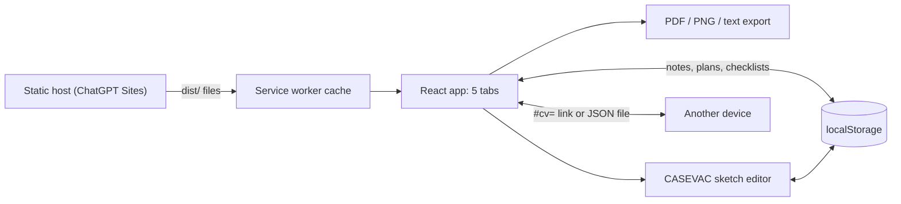

# OPORD Analyst (`Op-help`)

A mobile-first reference, worksheet and briefing aid for writing and briefing a
five-paragraph order (Orientation + SMEAC) the way the EULC "Issue a Combat Order" course
teaches and grades it, written so someone with no tactical background (a clinician in the
course, for example) can follow it end to end. It adds METT-T mission analysis, a CASEVAC
planner that draws HLZ, CCP and evacuation-route sketches, and a tactical reference. It is
a client-only React app built to a static site: it runs in any modern phone, tablet or
desktop browser, keeps all data in that browser, works offline after one visit, and is
hosted on ChatGPT Sites at <https://op-help.annonable.chatgpt.site>.

**Status:** FAR, 2026-10-23. The live site works, but GitHub `main` is behind it: the
live build includes Codex PRs #12 to #14, which are still open. Current milestone: `main`
matches the live site. See `HANDOFF.md`.

## Capabilities

"Verified" means it was exercised in a browser or test on 2026-10-23 (headless Chromium at
phone, small-phone and desktop sizes, light and blackout). No real iPhone or iPad has been
tested yet.

- GUIDE, ANALYZE, ORDER, CASEVAC and TOOLS tabs render without errors: verified
- GUIDE: method, graded-checklist rehearsal tracker, worked examples, task verbs, glossary: renders verified; tracker ticking not exercised
- ORDER: Orientation and paragraphs 1 to 5 with the grading points, TEMPLATE, tasking-statement builder: verified
- GET GRID (GPS to MGRS into a note): verified with emulated geolocation
- INSERT INTO ORDER (CASEVAC paragraph 4.a into the ORDER tab): verified
- PDF export of every tab on US Letter, copy as text: verified
- CASEVAC HLZ, CCP and route sketches with the 10:1 obstacle check, wind, and the 1-hour POI to surgical check: verified (plus unit tests)
- CASEVAC sketch editor: tap to select, drag, pinch and wheel zoom, add, delete, undo and redo, typed grids, arrow-key nudges: verified
- CASEVAC 9-line read-aloud script with MIST, and the graded paragraph 4.a: verified (unit tests)
- CASEVAC exports: PNG per sheet and the packet PDF, including pasted non-breaking spaces: verified
- Moving a plan between devices: SEND LINK (plan in the URL fragment) and SAVE FILE / OPEN FILE: verified
- Offline use and home-screen install (service worker, manifest), served from a subpath: verified
- Live site: all five tabs, the sketch editor, offline reload and PDF export: verified against <https://op-help.annonable.chatgpt.site>
- Blackout (red-on-black) mode across the app and sketches: verified
- Live compass with grid and magnetic arrows (real G-M angle): unverified this session (needs device sensors)
- Dictation into notes: unverified this session (only the microphone release on tab change was checked, with a fake recognizer)
- PCC/PCI checklist editing: renders verified; editing not exercised
- Named plans, backup and restore, and data wipe: on the live site from open PRs #13 and #14; not on `main`; not exercised by this wrap

## Install

Needs Node.js 20 or newer and git. Tested from a fresh clone on 2026-10-23 (install took
about 10 seconds with a warm npm cache):

```bash
git clone https://github.com/aarzamen/Op-help
cd Op-help
npm install
```

## Run

```bash
npm run dev        # http://localhost:3000
```

Other commands: `npm run build` (static site to `dist/`), `npm run preview` (serve the
build on :4173), `npm test` (unit tests), `npm run typecheck`, `npm run lint`. CI runs
typecheck, lint, tests and build on every PR and on `main`.

To publish: `npm ci && npm run build`, then upload `dist/` to any static host over HTTPS.
Asset paths are relative, so a domain root or a subpath both work, with no rewrites. The
ChatGPT Sites project is recorded in `.openai/hosting.json`. Deploy only from `main`.

## Layout

```
index.html, public/        entry page, icons, web app manifest
src/main.tsx, src/App.tsx  React root, service-worker registration, app shell and nav
src/views/                 GUIDE, ANALYZE, ORDER and TOOLS tabs
src/casevac/               CASEVAC planner (own module; reaches the app only via host.ts)
  workspace/               full-screen sketch editor (camera, gestures, items, inspector)
src/components/            shared UI: accordions, notes and dictation, forms, compass, icons
src/content/               doctrine as data: grading rubric, templates, task verbs, glossary
src/lib/, src/export/      storage helpers, checklists, PDF-safe text, exporters
tools/                     build plugin that writes dist/sw.js, and the service worker
docs/                      specs and DESIGN-SYSTEM.md (what each color means)
AGENTS.md, CLAUDE.md       rules for coding agents (CLAUDE.md imports AGENTS.md)
HANDOFF.md                 current state and next steps
```

## Architecture

Everything runs in the visitor's browser. Nothing is sent to a server: the host only
serves static files, and a CASEVAC link carries the plan in the URL fragment, which
browsers never send.



## Configuration

None. There are no environment variables, API keys or server settings. The only hosting
file is `.openai/hosting.json` (the Sites project id; no secrets).

## Known issues

- GitHub `main` is behind the live site: open PRs #12 (offline fix for hosts that send
  `Vary: Origin`, likely needed on iPhone Safari), #13 (named plans and backup) and #14
  (data wipe) are deployed but unmerged. Do not redeploy from `main` until they merge.
- Not yet tested on a real iPhone or iPad.
- OPSEC: operational text is stored unencrypted in the browser. A typed-confirmation wipe
  exists in open PR #14; there is no encryption.
- On Android, the compass may mix relative and absolute orientation readings and drift.
- `npm audit` reports issues in build tools and in DOMPurify (pulled in by jsPDF for an
  HTML-to-PDF path this app does not use).
- On phones, the CCP and route sketches open small; pinch to zoom.
- Dragging the overlay opacity slider rewrites the stored image on every step, which can
  stutter on phones.

## Next steps

See `HANDOFF.md`.

## Attribution

Built with Claude Code, directed by Mike Arzamendi. Publishing to ChatGPT Sites and PRs
#11 to #17 were done with Codex.
